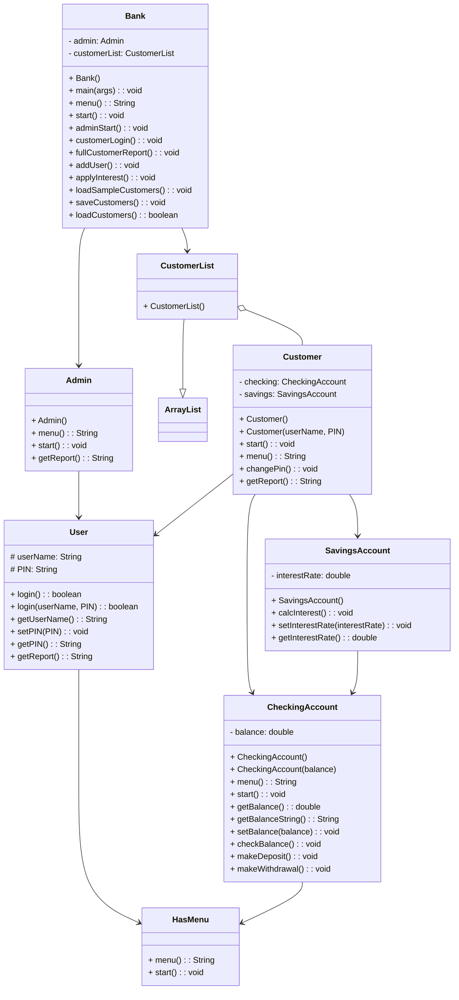

# CS121 Project 10 'Bank on it part 2'

## mermaid live diagram


## HasMenu{}
```
  String menu()
  void start()
```

### String menu()
```
  display the menu options

  return the user's selected menu option
```

### void start()
```
  accept user input

  use if statements to determine which menu option
  the user selected

  perform the appropriate action
```

## CheckingAccount{} // implements HasMenu, Serializable
```
  double balance

  CheckingAccount()
  CheckingAccount(double balance)
  main()
  String menu()
  void start()
  double getBalance()
  String getBalanceString()
  void setBalance(double balance)
  void checkBalance()
  private double getDouble()
  void makeDeposit()
  void makeWithdrawal()
```

### CheckingAccount()
```
  set balance equal to 0
```

### CheckingAccount(double balance)
```
  set this.balance equal to incoming balance
```

### String menu()
```
  print the CheckingAccount menu
    0) quit
    1) check balance
    2) make deposit
    3) make withdrawal

  print "Please enter (0-3): "
```

### void start()
```
  accept user input

  if 0 is entered
    exit the account menu
  else if 1 is entered
    call checkBalance()
  else if 2 is entered
    call makeDeposit()
  else if 3 is entered
    call makeWithdrawal()
```

### double getBalance()
```
  return this.balance
```

### String getBalanceString()
```
  format this.balance as a currency string
  return the formatted string
```

### void setBalance(double balance)
```
  if incoming balance is greater than or equal to 0
    set this.balance equal to incoming balance
  else
    print an error message
```

### void checkBalance()
```
  print the current account balance
```

### private double getDouble()
```
  accept user input

  try to parse the input String into a double

  catch NumberFormatException
    print an error message
    return 0
```

### void makeDeposit()
```
  prompt user to enter deposit amount
  accept user input

  if amount is greater than 0
    add amount to balance
    print new balance
  else
    print an error message
```

### void makeWithdrawal()
```
  prompt user to enter withdrawal amount
  accept user input

  if amount is less than or equal to 0
    print an error message
  else if amount is greater than balance
    print insufficient funds
  else
    subtract amount from balance
    print new balance
```

## SavingsAccount{} // extends CheckingAccount
```
  double interestRate

  SavingsAccount()
  SavingsAccount(balance)
  SavingsAccount(balance, interestRate)
  calcInterest()
  void setInterestRate(interestRate)
  double getInterestRate()
```

### SavingsAccount()
```
  call the parent constructor
  set the default interest rate to 5%
```

### calcInterest()
```
  calculate interest using the current balance and interest rate

  add the interest to the current balance

  print the new balance
```

### void setInterestRate(interestRate)
```
  if interest rate is greater than or equal to 0
    set interestRate equal to incoming interest rate
  else
    print an error message
```

### double getInterestRate()
```
  return the interestRate variable
```

## User{} // implements HasMenu, Serializable
```
  String userName
  String PIN

  boolean login()
  boolean login(userName, PIN)
  String getUserName()
  void setPIN(PIN)
  String getPIN()
  void start()
  String menu()
  String getReport()
```

### boolean login()
```
  prompt user for username
  accept username input

  prompt user for PIN
  accept PIN input

  compare entered username and PIN with stored information

  return true if both match
  return false if either does not match
```

### boolean login(userName, PIN)
```
  compare incoming username and PIN with this user's information

  return true if both match
  otherwise return false
```

### String getUserName()
```
  return the userName variable
```

### void setPIN(PIN)
```
  set the class PIN equal to incoming PIN value
```

### String getPIN()
```
  return the PIN variable
```

### String getReport()
```
  return a report containing the user's information
```

## Customer{} // extends User
```
  CheckingAccount checking
  SavingsAccount savings

  Customer()
  Customer(userName, PIN)
  void start()
  String menu()
  void changePin()
  String getReport()
  CheckingAccount getCheckingAccount()
  SavingsAccount getSavingsAccount()
```

### Customer()
```
  call the constructor with default username and PIN
```

### Customer(userName, PIN)
```
  call the User constructor

  create a new CheckingAccount
  create a new SavingsAccount
```

### void start()
```
  display the Customer menu

  accept user input

  if 0 is entered
    exit the customer menu
  else if 1 is entered
    call checking.start()
  else if 2 is entered
    call savings.start()
  else if 3 is entered
    call changePin()
```

### String menu()
```
  print the Customer menu
    0) Exit
    1) Manage Checking Account
    2) Manage Savings Account
    3) Change PIN

  return the user's selection
```

### void changePin()
```
  prompt user for current PIN
  accept user input

  if current PIN does not match
    print an error message
    return

  prompt user for new PIN
  accept user input

  if new PIN is empty
    print an error message
  else
    update the PIN
    print success message
```

### String getReport()
```
  create a report containing:
    customer username
    checking account balance
    savings account balance
    savings interest rate
    total account balance

  return the report
```

### CheckingAccount getCheckingAccount()
```
  return the checking account object
```

### SavingsAccount getSavingsAccount()
```
  return the savings account object
```

## Admin{} // extends User
```
  Admin()

  String menu()
  void start()
  String getReport()
```

### Admin()
```
  call the User constructor

  set username to "admin"
  set PIN to "0000"
```

### String menu()
```
  print the Admin menu
    0) Exit this menu
    1) Full customer report
    2) Add user
    3) Apply interest to savings accounts

  return the user's selection
```

### void start()
```
  leave this method empty

  the Bank class will handle all admin actions
```

### String getReport()
```
  return a report containing the admin username
```

## CustomerList{} // extends ArrayList<Customer>
```
  CustomerList()
```

### CustomerList()
```
  create an ArrayList that stores Customer objects

  this class is used to make customer data serialization easier
```

## Bank{} // implements HasMenu
```
  Admin admin
  CustomerList customerList

  Bank()
  main()
  String menu()
  void start()
  void adminStart()
  void customerLogin()
  void fullCustomerReport()
  void addUser()
  void applyInterest()
  void loadSampleCustomers()
  void saveCustomers()
  boolean loadCustomers()
```

### Bank()
```
  create a new Admin object
  create a new CustomerList

  attempt to load saved customer information

  if customer data cannot be loaded
    load sample customers
    save customer information

  call start()

  save customer information when the program exits
```

### String menu()
```
  print the Bank menu
    0) Exit system
    1) Login as admin
    2) Login as customer

  return the user's selection
```

### void start()
```
  display the Bank menu

  accept user input

  if 0 is entered
    exit the system
  else if 1 is entered
    attempt to login as admin

    if login is successful
      call adminStart()
    else
      print incorrect username or PIN
  else if 2 is entered
    call customerLogin()
```

### void adminStart()
```
  display the Admin menu

  accept user input

  if 0 is entered
    exit the Admin menu
  else if 1 is entered
    call fullCustomerReport()
  else if 2 is entered
    call addUser()
  else if 3 is entered
    call applyInterest()
```

### void customerLogin()
```
  prompt user for username
  accept username input

  prompt user for PIN
  accept PIN input

  set currentCustomer equal to null

  go through every customer in customerList

    if customer login is successful
      set currentCustomer equal to that customer
      exit the search

  if currentCustomer is null
    print incorrect username or PIN
  else
    call currentCustomer.start()
    save customer information
```

### void fullCustomerReport()
```
  print "Full customer report"

  go through every customer in customerList

    print the customer's username
    print checking account balance
    print savings account balance
```

### void addUser()
```
  print "Add User"

  prompt user for name
  accept name input

  prompt user for PIN
  accept PIN input

  check that name and PIN are not empty

  check that the username does not already exist

  create a new Customer using the name and PIN

  add the new customer to customerList

  save customer information
```

### void applyInterest()
```
  print "Apply interest"

  go through every customer in customerList

    call calcInterest() on the customer's savings account

  save customer information
```

### void loadSampleCustomers()
```
  clear the current customerList

  create Alice
    username: Alice
    PIN: 1111
    checking balance: $1000.00
    savings balance: $1000.00

  create Bob
    username: Bob
    PIN: 2222

  create Cindy
    username: Cindy
    PIN: 3333

  add all three customers to customerList
```

### void saveCustomers()
```
  create an ObjectOutputStream

  open the customers.dat file

  write customerList to the file

  close the output stream

  catch IOException if an error occurs
```

### boolean loadCustomers()
```
  create an ObjectInputStream

  open the customers.dat file

  read the saved customer information

  set customerList equal to the saved information

  close the input stream

  return true if loading is successful

  catch IOException or ClassNotFoundException
    return false
```

### main()
```
  create a new Bank object

  the Bank constructor starts the application
```

## Serialization
```
  Customer
  User
  CheckingAccount
  SavingsAccount

  all classes containing customer information must be serializable
```

### Customer
```
  extends User

  contains CheckingAccount and SavingsAccount objects

  must be serializable
```

### User
```
  contains username and PIN information

  must be serializable
```

### CheckingAccount
```
  contains the account balance

  must be serializable
```

### SavingsAccount
```
  extends CheckingAccount

  inherits serialization functionality
```

### CustomerList
```
  extends ArrayList<Customer>

  stores all Customer objects

  used as the object that is saved and loaded
```

## Running the Program

### Compile the program
```
  make
```

### Run the program
```
  make run
```

### Clean the project
```
  make clean
```

## Default Login Information

### Admin
```
  Username: admin
  PIN: 0000
```

### Sample Customers
```
  Alice
  Username: Alice
  PIN: 1111

  Bob
  Username: Bob
  PIN: 2222

  Cindy
  Username: Cindy
  PIN: 3333
```

## Saving Customer Information
```
  customer information is saved in customers.dat

  customer information is loaded when the Bank starts

  customer information is saved when the application exits

  customer information is also saved after customer and admin changes
```


